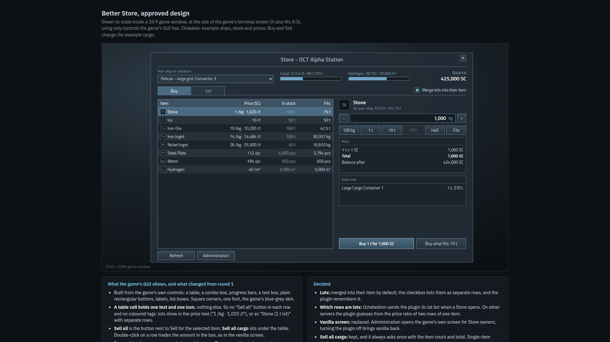

# Better Store: design

Approved by Viktor on 2026-11-14. The mockup in [mockup/store-screen.html](mockup/store-screen.html)
shows the screen to scale and can be clicked through. Its ships, stock and prices are examples.

## What the game gives us

Facts from the decompiled game code, version 1.210.

- The Store screen is `MyStoreBlockViewModel` with an EmptyKeys view. The Store lists its items
  with `MyStoreBlock.CreateGetStoreItemsRequest`. An item is an offer (the Store sells) or an
  order (the Store buys), of type PhysicalItem, Oxygen, Hydrogen, Gas or Grid, with an integer
  amount and an integer price per unit.
- A trade is one request, `CreateBuyRequest` or `CreateSellItemRequest`, and it names exactly
  one target entity: a block with an inventory, a gas tank, or the character. The server puts
  everything bought into that one inventory, or takes everything sold from it. A trade that
  doesn't fit, or isn't there, is refused whole.
- The inventories a player may trade with come from `CreateGetConnectedGridInventoriesRequest`:
  the blocks behind the Store grid's connectors that are connected and have trading turned on,
  plus the character.
- One unit of a gas offer is 1,000 L. Buying gas fills one tank per request.
- A Store's order for Hydrogen, Oxygen or another gas does nothing when a player sells to it:
  the server's sell code handles physical items only.
- The server drops some bad requests without an answer, for example a trade with a block of a
  grid the player's faction owns but the player doesn't.
- The vanilla screen takes its amounts as a typed number, and its only shortcut is one that sets
  the whole stock of the offer.

## The screen

It replaces the vanilla Store screen for everyone who has the plugin on. It is built from the
game's own GUI controls: a table, a combo box, progress bars, a text box, rectangular buttons,
labels and list boxes. It has the size of the terminal screen, so it fits a 4:3 window too.

A table cell holds one text and one icon, so rows can't carry buttons or colored tags. Every
action on an item is in the panel on the right.

### Top row

- **Your ship**: a combo box of the docked grids that the Store may trade with, one entry per
  grid, and "Character" for the suit. The first ship is selected when the screen opens.
- **Cargo** and **Hydrogen**: progress bars over all inventories, or all hydrogen tanks, of the
  selected ship, with the volume as text. While an amount is entered, a second bar shows how
  much the trade would add.
- **Balance**: the player's money.

### Buy and Sell tabs

One table per tab, 15 rows before it scrolls. Click a column header to sort.

| Buy | Sell |
|---|---|
| Item | Item |
| Price | Store pays |
| In stock | Store wants |
| Fits | You have |

**Fits** is the most the player can buy of the item: the smallest of the free space on the ship,
the player's money and the Store's stock. **You have** counts the item over the whole ship.

Amounts show in kg below a tonne and in tonnes above it, pieces for components and tools, m³ for
gas. Grid offers (ships for sale) stay as in vanilla: amount 1, with the preview.

Orders for gas and for ships are left out of the Sell tab, since selling to them does nothing.

Double-click on a row trades the amount in the box, as the vanilla screen does.

### The trade panel

For the selected row:

- The item, how much of it is on the ship, and how much fits or can be sold.
- The amount: a text box with **−** and **+** next to it. The buttons step by the leading digit
  of the amount: 100 kg steps below a tonne, 1 t steps up to 10 t, and so on. Typing takes plain
  numbers, thousands separators, and a `t` or `k` suffix for thousands: `2.5t` is 2,500 kg.
- Six preset buttons. For items by weight: 100 kg, 1 t, 10 t, 100 t, Half, and Fits (Buy) or
  All (Sell). For pieces: 1, 10, 100, 1,000, Half, Fits or All. For gas: 10, 100, 1,000 and
  10,000 m³, Half, Fill. A preset over the maximum is disabled.
- **Price**: the lines the trade is made of, the total, and the balance after it.
- **Goes into** (Buy) or **Taken from** (Sell): the containers or tanks the trade will use, with
  the amount for each. Three lines; with more containers the last line counts the rest. An
  amount that doesn't fit, or isn't on board, shows as a red line and disables the trade.
- **Buy** or **Sell**, with the amount and the total on the button.
- **Buy what fits**, **Fill tanks** or **Sell all**: the same trade at the maximum, in one click.

### Bottom row

- **Refresh** reloads the Store's items.
- **Administration** opens the game's own Store screen. Only the Store's owner sees it.
- **Sell all cargo**, on the Sell tab: sells all of every item on the ship that the Store wants.
  It always asks once, with the number of items and the total. No other trade asks.
- A status line with the result of the last trade. When the server refuses a trade, the game's
  message box says why, as today.

## Splitting a trade over the ship

The plugin plans the trade on the client and sends one request per container or tank.

- **Buying** fills the inventories in the order the screen lists them, each up to its free
  volume.
- **Selling** takes from the inventories that hold the item, in the same order.
- **Gas** goes to the tanks of that gas with free room, in order.
- The requests go out one after the other. Each waits for the result of the one before, because
  the server answers a request through one callback per Store block. If the server refuses one,
  the plugin stops, shows the refusal, and reports what was traded up to there. It also stops
  when the server gives no answer for 10 seconds.
- After the last result the plugin reloads the Store's items and the balance.

The plan is made from what the client knows of the inventories, and the server decides. A
container that changed meanwhile can make one request fail; the trade then ends early, with
nothing lost.

## Tonne lots

Some servers list a bulk item twice: once by the unit and once in lots of 1,000 units, as
Octahedron does. A lot row is the same item as the unit row. Only its price differs, and a trade
on it moves 1,000 units for each one traded.

- **Merged**, the default: the two rows show as one item, priced per unit and per tonne. The
  amount is entered in kg. The plugin trades whole lots where the lot row has the better price
  per kg and the rest on the unit row, and the other way around where the unit row is better.
  An item with a lot row only, like Octahedron's ice, trades in whole tonnes.
- **Separate**: every Store row is its own table row, the lot row named "Stone (1 t lot)", with
  its amounts in lots.

A checkbox on the screen, "Merge lots into their item", switches between the two. The plugin
remembers it.

A whole lot has to fit into one container, since it is one unit of one request.

### Knowing which rows are lots

The client can't see it in the Store's items. Two sources, in this order:

1. **The server says so.** When a player opens a Store, the server sends that Store's rows of
   lots to the client as a mod message (`SendMessageTo`) on channel 14860. The message is UTF-8
   text: the line `BetterStoreLots 1`, then one line `<store item id> <lot size>` for each row
   of lots. After the first such message the plugin stops guessing for the rest of the session.
   Octahedron doesn't send it yet. It is the only way to recognize an item sold in lots only.
2. **A guess from the prices**, on servers that say nothing: two rows of the same item and the
   same kind (both offers, or both orders), with one priced 800 to 1,250 times the other, are
   a unit row and a lot row. A lone row on the other side priced like that lot row is one too.

## Configuration

- Enabled. Off brings the vanilla Store screen back without disabling the plugin.
- Merge lots into their item. The checkbox on the screen.

## Out of scope

- The Store's administration: offers, orders and their prices stay on the game's own screen.
- Gamepad control. With a gamepad the game's own Store screen opens.
- The ATM and the contract block.
