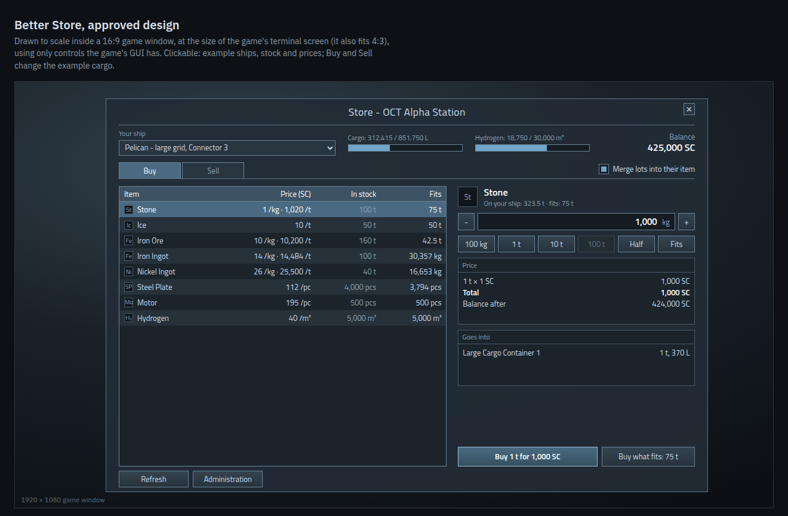

# Better Store

Space Engineers client plugin for [Pulsar](https://github.com/SpaceGT/Pulsar) that replaces the
screen of the Store block with one that is quicker to trade on.

**Status:** designed, not implemented yet. [Docs/Design.md](Docs/Design.md) is the approved
design. The plugin is not on PluginHub.

The picture is a mockup drawn to the game's scale. Open
[Docs/mockup/store-screen.html](Docs/mockup/store-screen.html) in a browser to click through it.

## What it changes

- **Your ship instead of a container.** The vanilla screen makes you pick one cargo container or
  tank for every trade. Here you pick a docked ship, or your suit. What you buy goes into the
  containers that have room for it, and what you sell comes from the containers that hold it.
  The screen shows which containers a trade will use before you make it.
- **Round amounts without typing.** One click sets 100 kg, 1 t, 10 t, 100 t, half, or everything.
  The − and + buttons step by the leading digit. You can still type, and "2.5t" works.
- **Buy what fits.** The Fits column and button give the most you can buy of an item: the
  smallest of your free cargo space, your money and the Store's stock.
- **Sell all.** One button sells all you have of the selected item, up to what the Store wants.
  Another one sells all the cargo on the ship that the Store wants, after asking once.
- **Gas.** A gas offer fills the hydrogen or oxygen tanks of the ship, spread over them.
- **Tonne lots.** Some servers sell bulk goods in 1,000 kg lots next to single units, like the
  Octahedron world does. The plugin merges the two rows into one item priced per kg and per
  tonne, and buys or sells the cheapest mix. A checkbox lists them as separate rows instead.

Store owners still manage their Store on the game's own screen, behind the Administration button.
Disable the plugin to get the vanilla Store screen back.

## Bug reports

Please open an issue on [GitHub](https://github.com/viktor-ferenczi/se-better-store/issues).

## Building

Made from the [client plugin template](https://github.com/CometWorks/client-plugin-template).
`Directory.Build.props` finds the game through Steam. To set the path yourself, put `Bin64` into
a `Directory.Build.props.user` file in the repository root (`setup.py` writes one for you).
For testing, add the working copy to Pulsar as a development folder (start Pulsar with
`-sources`, then use the Sources button).
